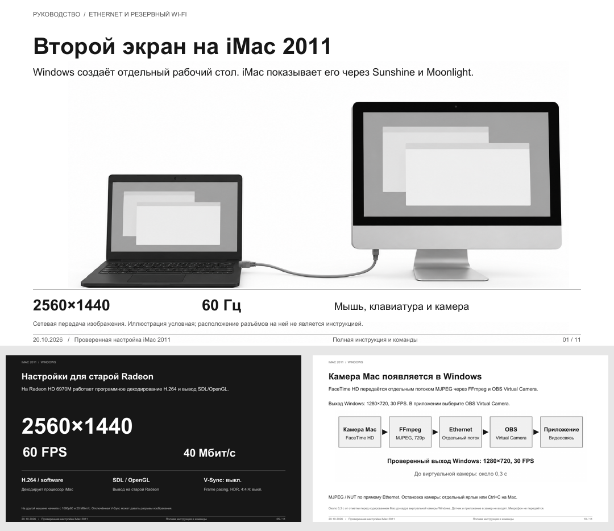

# iMac 2011 как второй экран Windows

Руководство по передаче рабочего стола Windows на 27-дюймовый iMac Mid 2011 через Sunshine и Moonlight. Для отдельного рабочего стола используется виртуальный монитор Windows с разрешением 2560×1440 и частотой 60 Гц.

- [Читать руководство](docs/guide.ru.md)
- [Скачать руководство в PDF](docs/imac-second-monitor-guide.pdf)
- [Скрипт камеры для Mac](scripts/iMac-Camera.command) и [настройка буферизации OBS](scripts/camera-low-latency.lua)

Проверенная связка: Windows 11, Sunshine 2026.914.233613, Virtual Display Driver 25.7.23 beta; iMac с macOS Ventura 13.5.1, OCLP 0.6.8 и Moonlight 6.2.0. На старой Radeon HD 6970M работает программное декодирование H.264 и вывод через OpenGL.

Репозиторий содержит документацию и два примера скриптов камеры. Установщика и универсальной автоматической настройки в нём нет. Примеры требуют ручной установки FFmpeg и OBS, выбора сетевых адресов и разрешения камеры в macOS. Расширенный рабочий стол 1440p, управление с Mac и переключение провод/Wi-Fi проверены на одной системе. Полный запуск обоих компьютеров после выключения ещё не проверен.

Это сетевой видеопоток. HDMI-вход, прошивка дисплея и переделка электроники iMac не используются.

Камера iMac передаётся по прямому Ethernet 1 Гбит/с через FFmpeg, MJPEG/NUT и OBS Virtual Camera. Проверен выход Windows 1280×720 при 30 FPS. В контрольном замере задержка от часов, наложенных на Mac перед кодированием, до кадра виртуальной камеры Windows уменьшилась с 1,3–1,4 с до 0,25–0,29 с. Замер не включает задержку датчика камеры и приложения видеосвязи. MJPEG требует больше пропускной способности, чем прежний H.264; Wi-Fi для камеры не проверен. Микрофон не передаётся.
