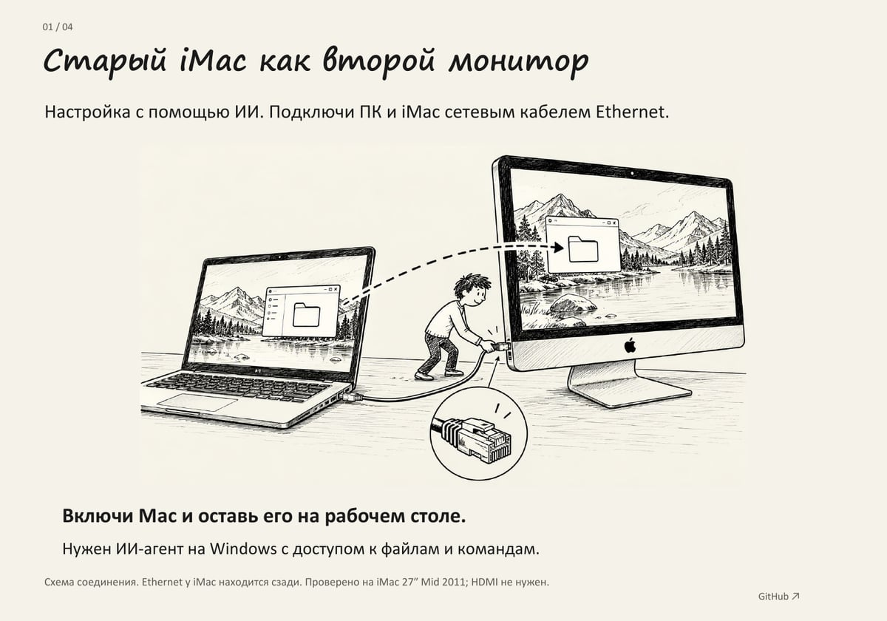

# Старый iMac как второй монитор

Windows создаёт отдельный рабочий стол, Sunshine передаёт его по сети, Moonlight показывает на iMac. Окна Windows можно переносить на экран Mac.

| Как настроить | Инструкция | PDF |
| --- | --- | --- |
| Самостоятельно | [Ручная настройка, шаг за шагом](docs/manual-setup.ru.md) | [Скачать ручной гайд](docs/imac-manual-setup.ru.pdf) |
| С помощью ИИ | [Задание агенту](docs/prompt.ru.txt) и [база знаний](docs/agent-setup.ru.md) | [Четыре страницы для начала](docs/imac-ai-quickstart.ru.pdf) |

Ручной вариант выполняется на двух компьютерах без SSH. В варианте с ИИ нужен агент с доступом к файлам и командам Windows и настроенный доступ к Mac.

В ручном PDF девять коротких страниц: программы, сеть, PIN, отдельный экран, качество и обычный запуск. В коротком PDF для варианта с ИИ четыре страницы: кабель, доступ к Mac, задание агенту, проверка экрана.

Рисунки показывают схему действий, а не точные скриншоты. Названия пунктов зависят от версии macOS.

[](docs/imac-ai-quickstart.ru.pdf)

## Начать настройку с ИИ

1. Включи iMac и соедини его с ПК кабелем Ethernet. Для первого доступа оба компьютера также могут быть в одной домашней сети. Прямое соединение по кабелю агент настроит после проверки адресов.
2. На Mac включи «Удалённый вход» и разреши доступ только своему пользователю. Для Ventura: меню Apple → Системные настройки → Основные → Общий доступ. В старой macOS раздел «Общий доступ» находится сразу в системных настройках.
3. Отправь агенту адрес вида `имя@адрес` из сведений об удалённом входе и [готовый текст задания](docs/prompt.ru.txt). Пароль вводи в локальном запросе, не в чате. Если первого подключения ещё нет, агент даст короткий шаг для обмена ключом и проверки компьютера.
4. Подтверди установку программ и PIN сопряжения в системных окнах. После настройки перетащи окно на iMac. Для отдельного рабочего стола в Windows выбирается Win + P → «Расширить».

## Текст для агента

```text
Настрой мой iMac как второй экран Windows по инструкции:
https://github.com/yakindr1/imac-second-monitor

Сначала прочитай AGENTS.md и docs/agent-setup.ru.md.
Выполни настройку, сохрани текущую сеть и проверь результат.
Задавай вопросы только там, где без моего действия продолжить нельзя.
```

[AGENTS.md](AGENTS.md) задаёт порядок работы. [База знаний агента](docs/agent-setup.ru.md) содержит проверку совместимости, доступ по SSH, сеть, установку, выбор виртуального экрана, качество, автозапуск и восстановление. Это инструкция для агента, а не автоматический установщик.

## Качество и задержка

На проверенном iMac 27″ Mid 2011 использовались 2560×1440, 60 FPS, H.264 и 40 Мбит/с. Для чёткого текста нужно родное разрешение панели. Размер интерфейса меняется масштабом Windows. Для другой модели и сети агент подбирает настройки по результату проверки.

На этой системе дублирование давало худшие качество и задержку, поэтому рабочий вариант использует расширение экрана. Ethernet был проверен на соединении 1 Гбит/с. Wi-Fi работает как запасной вариант, но его качество зависит от сети.

## Где способ проверен

Windows 11 с NVIDIA RTX и встроенной Intel; iMac 27″ Mid 2011 с Radeon HD 6970M. Установлены macOS Ventura 13.5.1 через OCLP 0.6.8, Moonlight 6.2.0, Sunshine 2026.914.233613 и Virtual Display Driver 25.7.23 beta. Для старой Radeon использовались программное декодирование H.264 и SDL/OpenGL.

Это описание одной работающей установки. Ventura не является штатно поддерживаемой системой для iMac 2011. Ставить её ради этого способа инструкция не требует. Moonlight 6.2.0 требует macOS 13; для более ранних систем смотри [таблицу версий в ручном гайде](docs/manual-setup.ru.md#1-проверь-модель-и-систему-mac). Старые ветки с этим Sunshine здесь не проверены. Полный запуск обоих компьютеров после выключения ещё не проверен.

Экран передаётся по сети. Перепрошивка, HDMI-вход и переделка электроники не требуются. iMac Connect в персональной установке управляет той же связкой программ; универсального установщика этого приложения в репозитории нет.

## Подробности

[Развёрнутый технический гайд](docs/guide.ru.md) и [прежняя подробная PDF-версия](docs/imac-second-monitor-guide.pdf) сохранены. Там также описан отдельный способ передачи камеры. Камера, OBS и FFmpeg для второго экрана не нужны.

Основные источники: [Sunshine](https://docs.lizardbyte.dev/projects/sunshine/latest/md_docs_2getting__started.html), [Moonlight](https://github.com/moonlight-stream/moonlight-docs/wiki/Setup-Guide), [удалённый вход macOS](https://support.apple.com/en-gb/guide/mac-help/mchlp1066/13.0/mac/13.0), [несколько экранов Windows](https://support.microsoft.com/en-us/windows/hardware/display-graphics/how-to-use-multiple-monitors-in-windows). Точные версии и ссылки на их параметры собраны в базе знаний агента.
